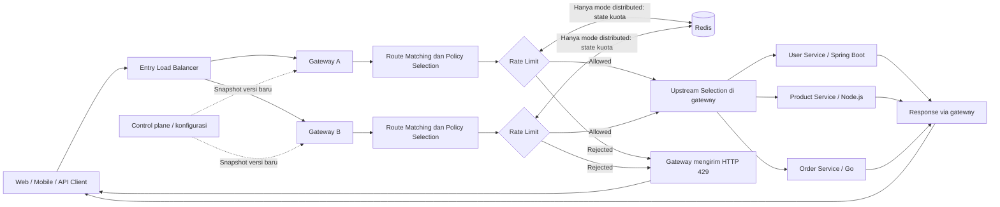
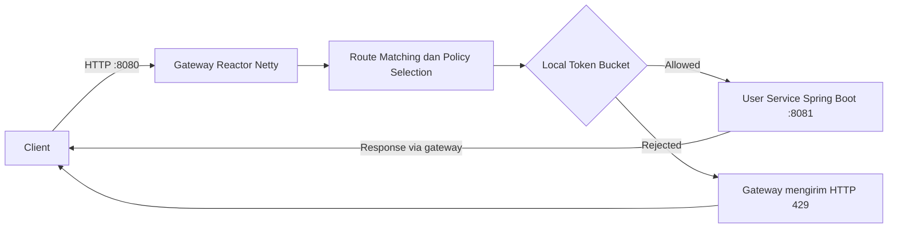

# Distributed API Gateway — Product Requirements Document

**Versi:** 1.0  
**Tanggal:** 22 Oktober 2026  
**Status:** Draf untuk review; implementasi bertahap  
**Jenis proyek:** Perangkat lunak infrastruktur open-source dan eksperimen engineering  
**Nama repo kerja:** `distributed-api-gateway`

## 1. Ringkasan

Distributed API Gateway adalah gateway HTTP berbasis Java 21 dan Reactor Netty yang menjadi pintu masuk ke beberapa backend service. Gateway mencocokkan rute, menentukan policy, mengevaluasi rate limit lokal, lalu meneruskan request yang diizinkan. Tahap berikutnya menambahkan load balancing, health check, rate limiting terdistribusi, konfigurasi dinamis, serta observability.

Proyek ini juga merupakan studi engineering: setiap strategi pembatasan trafik harus diuji dari sisi ketepatan kuota, latensi, throughput, fairness, dan perilaku saat komponen gagal. Hasil eksperimen harus dapat direproduksi. Proyek tidak mengklaim meniru sistem internal Uber atau siap dipakai di produksi sebelum validasi keamanan dan keandalan selesai.

**Pertanyaan utama:** Bagaimana strategi rate limiting terdistribusi menyeimbangkan ketepatan, latensi, throughput, fairness, dan ketahanan ketika trafik berjalan serentak di beberapa instance gateway?

## 2. Keputusan yang sudah disepakati

| Keputusan | Pilihan | Alasan |
|---|---|---|
| Implementasi gateway | Java 21 + Reactor Netty langsung | Mempelajari perilaku reverse proxy dan I/O non-blocking secara eksplisit. |
| Framework gateway | Tanpa Spring Boot pada data plane | Spring Boot tidak menjadi syarat untuk menjalankan gateway. |
| Demo backend pertama | Spring Boot | Memudahkan pembuatan service HTTP contoh. |
| Control plane kelak | Spring Boot, direncanakan | Cocok untuk API administrasi; tidak berada di jalur setiap request. |
| Repository awal | Monorepo, Gradle multi-project | Pengembangan dan pengujian antarmodul lebih sederhana. |
| Protokol awal | HTTP/1.1 | Membatasi kompleksitas proxy pada tahap awal. |
| Algoritma awal | Local Token Bucket pada tiap gateway | Fondasi untuk mempelajari concurrency dan batas kuota tanpa Redis. |
| Kuota bersama kelak | Redis-backed Token Bucket | Menjadi baseline kuota bersama lintas gateway. |

Versi dependensi dikunci saat implementasi dan diperbarui melalui pengujian kompatibilitas. Keputusan seperti lisensi, skema konfigurasi final, dan kebijakan kegagalan Redis masih terbuka di Bagian 17.

## 3. Masalah dan pengguna

Dalam arsitektur microservices, klien dapat menghadapi banyak alamat backend dan setiap service dapat menerapkan batas trafik dengan cara berbeda. Jika beberapa gateway berjalan bersamaan, limiter lokal di setiap instance dapat menggandakan kuota yang sebenarnya dimaksudkan global. Sebaliknya, pembacaan state terpusat pada setiap request menambah latensi dan ketergantungan operasional.

Pengguna sasaran:

1. **Pengembang backend** yang ingin menjalankan gateway di depan service HTTP tanpa mengubah bahasa atau framework backend.
2. **Pengembang platform/infrastruktur** yang ingin menguji routing, kebijakan trafik, dan perilaku saat gagal.
3. **Kontributor open-source dan pembelajar distributed systems** yang memerlukan implementasi, tes, dan eksperimen yang bisa diperiksa.

Pengguna gateway tidak wajib menulis backend dengan Java atau Spring Boot. Backend cukup menyediakan endpoint HTTP yang dapat dijangkau gateway.

### 3.1 Skenario pengguna

- **Sebagai pengembang backend**, saya ingin memetakan `/users/**` ke User Service dan `/orders/**` ke Order Service agar klien memakai satu alamat masuk.
- **Sebagai pengelola layanan**, saya ingin mengatur batas request per API key atau route agar lonjakan trafik tidak langsung membebani backend.
- **Sebagai pengelola beberapa gateway**, saya ingin batas global tetap berlaku saat jumlah instance gateway bertambah.
- **Sebagai kontributor**, saya ingin menjalankan tes dan benchmark dari repo dengan instruksi yang jelas agar perubahan perilaku dapat dibuktikan.

## 4. Tujuan dan ukuran keberhasilan

### 4.1 Tujuan produk

- Menyediakan reverse proxy HTTP yang meneruskan request dan response secara benar.
- Mendukung rute ke lebih dari satu service dan beberapa instance upstream.
- Menegakkan kebijakan rate limit lokal dan, kemudian, kuota bersama lintas gateway.
- Menjelaskan perilaku timeout, backend gagal, Redis gagal, dan perubahan konfigurasi.
- Menyediakan dokumentasi, contoh backend, container, tes integrasi, dan benchmark yang dapat dijalankan ulang.

### 4.2 Ukuran keberhasilan

Proyek dinilai berhasil sebagai produk pembelajaran dan portofolio bila pengguna baru dapat menjalankan gateway dari dokumentasi, mengganti upstream dengan service HTTP miliknya, mengamati beberapa gateway berjalan serentak, dan mereproduksi pengujian kuota serta kegagalan. Perbandingan performa harus menyertakan kondisi eksperimen dan data mentah. Kesiapan produksi adalah penilaian terpisah.

### 4.3 Bukan tujuan awal

- Menggantikan Envoy, Kong, APISIX, atau gateway produksi lain.
- Menjadi aplikasi bisnis e-commerce atau API management enterprise.
- Mengimplementasikan HTTP dari TCP mentah.
- Mendukung gRPC, WebSocket, HTTP/2 end-to-end, atau HTTP/3 pada MVP.
- Membuat Kubernetes operator, billing, atau marketplace.
- Mengklaim kuota global yang ketat untuk algoritma probabilistik.

## 5. Arsitektur

### 5.1 Arsitektur target



**Data plane** adalah instance gateway yang menangani request: validasi, pencocokan rute dan policy, evaluasi rate limit, pemilihan upstream, forwarding, penanganan kesalahan, dan metrik. Setiap instance menjalankan tahap ini sendiri; kotak upstream selection pada diagram mewakili tahap yang sama di masing-masing gateway. Pada mode lokal, Local Token Bucket di memori gateway mengambil keputusan tanpa Redis. Pada mode terdistribusi, limiter memakai Redis untuk membaca dan memperbarui state kuota bersama. Redis tidak mengirim respons HTTP; gateway yang mengirim `429` ke client. **Control plane** mengelola konfigurasi dan mendistribusikan snapshot yang sudah divalidasi. Control plane tidak dihubungi pada setiap request.

### 5.2 Topologi Milestone 1



Satu gateway, satu service contoh, rute statis, dan Local Token Bucket membuktikan alur awal. Redis, PostgreSQL, HAProxy, Grafana, dan control plane belum diperlukan pada tahap ini.

### 5.3 Siklus request

1. Gateway menerima HTTP request dan memvalidasi batas protokol dasar.
2. Gateway mencocokkan path dengan rute yang aktif dan mengambil policy milik rute itu. Rute tidak ditemukan menghasilkan `404` tanpa mengevaluasi rate limit.
3. Jika policy rate limit aktif, gateway mengevaluasi key dan kuota. Mode lokal memakai state di gateway; mode terdistribusi yang direncanakan memakai state Redis. Request ditolak oleh gateway dengan `429` tanpa diteruskan.
4. Gateway memilih upstream yang layak, lalu meneruskan method, path, query, body, dan header end-to-end yang aman.
5. Gateway mengembalikan status, header end-to-end, dan body dari upstream.
6. Gangguan koneksi dan timeout dipetakan ke respons gateway yang terdokumentasi; metrik dan log mencatat kategori kegagalan.

## 6. Persyaratan fungsional

Status **MVP** berarti wajib untuk Milestone 1. Status **Lanjutan** berarti wajib pada milestone berikutnya. **Eksperimen** berarti kandidat penelitian, bukan syarat rilis awal.

| ID | Persyaratan | Tahap | Kriteria penerimaan utama |
|---|---|---|---|
| FR-01 | Menerima HTTP/1.1 dan meneruskan GET serta POST. | MVP | Method, path, query, body, status, dan content type tetap benar. |
| FR-02 | Mencocokkan rute berdasarkan prefix path. | MVP | `/users/1` cocok ke `/users`; `/users-extra` tidak. Rute tak dikenal `404`. |
| FR-03 | Mengonfigurasi port, prefix rute, upstream URL, dan response timeout. | MVP | Nilai valid dimuat saat startup; nilai yang salah menggagalkan startup dengan pesan jelas. |
| FR-04 | Menangani upstream tidak tersedia dan timeout. | MVP | Koneksi gagal menghasilkan `502`; response timeout menghasilkan `504`. |
| FR-05 | Memperlakukan header hop-by-hop sesuai semantik HTTP. | MVP | Header seperti `Connection` dan header yang disebut di dalamnya tidak diteruskan. |
| FR-06 | Mendukung beberapa rute dan beberapa service backend. | Lanjutan | Setiap request mencapai service yang tepat tanpa logika bisnis di gateway. |
| FR-07 | Memilih instance upstream dengan Round Robin. | Lanjutan | Distribusi antarsatu pool terukur pada upstream sehat. |
| FR-08 | Memeriksa kesehatan upstream dan mengecualikan yang gagal. | Lanjutan | Upstream yang pulih dapat masuk kembali; semua upstream gagal memiliki respons terdefinisi. |
| FR-09 | Menegakkan Local Token Bucket per route pada gateway. | MVP | Tidak ada token terpakai ganda pada request serentak; gateway mengirim `429` dan tidak memanggil upstream. |
| FR-10 | Menegakkan distributed Token Bucket antar-gateway. | Lanjutan | Kuota bersama berlaku sesuai model yang didokumentasikan dan diuji dengan beberapa instance. |
| FR-11 | Mengelola rute dan policy melalui control plane. | Lanjutan | Konfigurasi tervalidasi, berversi, dapat diterapkan tanpa restart, dan dapat di-rollback. |
| FR-12 | Mengekspos health, metrics, dan log terstruktur. | Lanjutan | Trafik, latensi, penolakan, dan kegagalan upstream dapat dibedakan. |
| FR-13 | Membandingkan strategi rate limiting tambahan. | Eksperimen | Hasil fairness, overhead, overshoot, dan failure behavior dapat direproduksi. |
| FR-14 | Memperluas policy dan key lokal ke API key atau identitas client tepercaya. | Lanjutan | Key tidak dapat dipalsukan melalui header yang tidak tepercaya; jumlah bucket tetap terbatas. |

### 6.1 Kontrak forwarding

Pada MVP, GET dan POST adalah cakupan wajib. PUT, PATCH, DELETE, body besar, pembatalan request, dan streaming diuji serta disempurnakan sebelum klaim proxy generik atau rilis publik. Implementasi tidak boleh menyalin `Host`, `Connection`, `Transfer-Encoding`, atau header hop-by-hop lain secara membabi buta. Penanganan `Forwarded` dan `X-Forwarded-*` harus memiliki aturan trust boundary sebelum deployment terbuka.

Gateway tidak mengimplementasikan operasi bisnis seperti mengambil data user. Ia hanya meneruskan request ke service yang dipilih.

### 6.2 Routing dan load balancing

Rute minimal memiliki `id`, prefix path, dan satu atau lebih upstream. Urutan prioritas rute harus deterministik; konflik prefix harus divalidasi. Pada tahap beberapa upstream, Round Robin hanya memilih instance yang sehat. Algoritma lain seperti weighted round robin atau least connections adalah kandidat lanjutan, bukan kebutuhan MVP.

Contoh konfigurasi target berikut bersifat **ilustrasi kontrak**, belum menjadi skema final. Prototipe M1 saat ini memakai file `.properties` yang lebih kecil.

```yaml
server:
  port: 8080
routes:
  - id: users
    pathPrefix: /users
    upstreams:
      - http://user-service:8081
    responseTimeout: 5s
  - id: orders
    pathPrefix: /orders
    upstreams:
      - http://order-service:8082
    responseTimeout: 5s
```

### 6.3 Local Token Bucket

Gateway terlebih dahulu menentukan rute dan policy, lalu meminta limiter mengevaluasi request. Pada implementasi awal, key adalah **route ID** sehingga setiap gateway memiliki satu bucket lokal per rute yang dibatasi; kuota ini tidak global antar-instance. Bucket mempunyai kapasitas, jumlah token, laju isi ulang, dan waktu isi ulang terakhir. Implementasi memakai waktu monotonic dan transisi atomik agar token tidak terpakai ganda. Jika kelak key berasal dari API key, user ID, atau client IP tepercaya, jumlah bucket dan penghapusan bucket idle harus dirancang. Header respons rate limit diputuskan sebagai bagian kontrak HTTP sebelum fitur dirilis.

### 6.4 Distributed Token Bucket

Fitur ini aktif hanya bila policy mode distributed dipilih. Beberapa gateway memakai key bucket logis yang sama. Redis menyimpan state; operasi isi ulang dan pengambilan token dijalankan atomik, misalnya melalui Lua. Gateway tetap mengambil keputusan HTTP dan mengirim `429` bila kuota habis. Desain harus menentukan sumber waktu, TTL bucket, pola key, serta konsekuensi restart gateway. Tes membuktikan bahwa request serentak tidak memakai token yang sama dua kali dan kuota tidak berlipat karena jumlah gateway bertambah.

Saat Redis bermasalah, tiga kebijakan perlu dievaluasi: **fail-open** (trafik tetap jalan), **fail-closed** (request ditolak), dan **local fallback** (kuota sementara lokal). Tidak ada satu default yang dipilih tanpa membandingkan kebutuhan ketersediaan dan ketepatan kuota.

### 6.5 Konfigurasi dinamis

Setelah MVP, administrator mengubah rute, pool upstream, policy, dan timeout melalui API administrasi. Control plane memvalidasi perubahan, menyimpan versi, lalu mendistribusikan snapshot. Tiap gateway mengganti snapshot lokal secara atomik dan melaporkan versi aktif. Selama rollout, versi dapat berbeda sesaat antargateway; batas inkonsistensinya harus teramati dan didokumentasikan. Data plane tidak membaca PostgreSQL pada setiap request.

## 7. Persyaratan nonfungsional

| Area | Persyaratan |
|---|---|
| I/O | Jalur proxy memakai I/O non-blocking; operasi blocking tidak boleh berjalan di event loop. |
| Sumber daya | Connection pool, timeout, batas koneksi, payload, header, dan buffer harus terdefinisi sebelum rilis publik. |
| Keandalan | Backend lambat atau gagal tidak boleh menggantung request tanpa batas; shutdown harus melepaskan sumber daya. |
| Observability | Catat request per route/status, latensi gateway dan upstream, `429`, `502`, `504`, kesehatan upstream, serta error Redis. |
| Performa | Laporkan p50, p95, p99, throughput, error rate, CPU, dan memori; jangan menetapkan klaim throughput tanpa pengukuran. |
| Keamanan | Validasi alamat upstream, cegah open proxy/SSRF, batasi payload, sanitasi log, dan jangan mencatat credential atau body sensitif. |
| Portabilitas | Dapat dijalankan lokal dengan JDK 21 dan Gradle Wrapper; Compose menyediakan lingkungan demo. |
| Kompatibilitas | Backend HTTP tidak tergantung pada bahasa atau framework tertentu. |

Autentikasi, TLS, retries, circuit breaker, tracing penuh, dan dukungan protokol tambahan adalah keputusan bertahap. Jika retries ditambahkan, default-nya harus mempertimbangkan idempotency, replay body, retry budget, dan risiko memperbesar beban backend.

## 8. Keamanan dan batas kepercayaan

Gateway adalah komponen yang menerima input dari jaringan. Sebelum deployment publik, desain wajib mencakup:

- allowlist atau pembatasan alamat upstream; larangan akses metadata internal yang tidak diinginkan;
- validasi konfigurasi agar gateway tidak berubah menjadi open proxy;
- aturan jelas untuk `Forwarded`, `X-Forwarded-*`, identitas client, dan rate-limit key;
- batas ukuran request, header, koneksi, dan waktu tunggu;
- perlakuan terhadap header hop-by-hop, request smuggling, serta input path yang tidak lazim;
- dependency scanning, uji resource exhaustion, dan proses pelaporan kerentanan.

HTTP tanpa TLS hanya untuk lingkungan lokal. Strategi terminasi TLS di load balancer atau gateway dipilih sebelum deployment publik. Tidak ada klaim *production-ready* sebelum pemeriksaan keamanan dan operasi selesai.

## 9. Service contoh

Service contoh adalah fixture pengujian, bukan bagian dari runtime produk. User Service berbasis Spring Boot menyediakan `GET /users/{id}` dan endpoint echo POST untuk memeriksa forwarding body dan status. Tahap berikutnya dapat menambah Product Service (Node.js) dan Order Service (Go) untuk menunjukkan interoperabilitas bahasa.

Fixture lanjutan dapat menghasilkan delay, status error, body besar, atau koneksi yang terputus secara deterministik. Kontrol kegagalan ini hanya aktif di lingkungan tes.

## 10. Strategi repository dan distribusi

```text
distributed-api-gateway/
├── gateway/
│   ├── gateway-core/           # routing dan forwarding
│   ├── gateway-runtime/        # executable dan konfigurasi
│   └── gateway-ratelimit/      # pemisahan modul pada tahap pengembangan limiter
├── examples/
│   ├── user-service/           # Spring Boot, MVP
│   ├── product-service/        # tahap lanjutan
│   └── order-service/          # tahap lanjutan
├── control-plane/              # tahap lanjutan
├── config/
├── benchmarks/                 # tahap lanjutan
├── docs/
├── compose.yaml
├── settings.gradle
├── build.gradle
├── gradlew / gradlew.bat
└── README.md
```

Direktori masa depan pada diagram **tidak perlu dibuat kosong**. Gradle root memasukkan modul Java saja; contoh Node.js dan Go memakai alat build masing-masing. Setiap executable dapat dibangun dan dijalankan terpisah. Monorepo tidak berarti semua komponen harus dideploy bersamaan.

Untuk rilis open-source, sediakan dokumentasi cara menjalankan, referensi konfigurasi, batasan, arsitektur, tes, metode benchmark, panduan kontribusi, kebijakan keamanan, lisensi, dan catatan rilis.

## 11. Pengujian dan pembuktian

### 11.1 Piramida pengujian

- **Unit:** pencocokan rute, validasi konfigurasi, pemilihan upstream, refill token, dan pemetaan error.
- **Integrasi:** gateway nyata dengan backend nyata; status, header, query, body, timeout, koneksi gagal, startup, dan shutdown.
- **Concurrency:** local dan distributed rate limiter tidak melanggar invariant kuota.
- **Fault injection:** proses backend/gateway mati, Redis lambat atau gagal, dan gangguan jaringan.
- **Benchmark:** trafik terkontrol dengan k6; hasil mentah dan konfigurasi lingkungan disimpan.

### 11.2 Eksperimen yang direncanakan

| Eksperimen | Pertanyaan | Perbandingan utama |
|---|---|---|
| E01 — Proxy overhead | Berapa latensi tambahan gateway? | Langsung ke backend vs melalui gateway. |
| E02 — Load balancing | Seberapa merata distribusi dan pemulihannya? | Beberapa upstream sehat, gagal, lalu pulih. |
| E03 — Local bucket | Apakah hitungan token benar saat serentak? | Diterima/ditolak, burst, latensi. |
| E04 — Distributed bucket | Apakah kuota bersama bertahan saat jumlah gateway berubah? | Satu vs tiga gateway, overshoot, latensi Redis. |
| E05 — Redis failure | Bagaimana trade-off availability dan quota correctness? | Fail-open, fail-closed, local fallback. |
| E06 — Gateway failure | Seberapa cepat trafik dialihkan? | Request gagal dan p95/p99 saat failover. |
| E07 — Strategi lanjut | Kapan pendekatan tanpa cek Redis per request berguna? | Token bucket, quota leasing, probabilistic dropping. |

Setiap laporan eksperimen harus menyebut hipotesis, versi kode, spesifikasi hardware, jumlah instance, versi Java, argumen JVM, payload, warm-up, durasi, profil trafik, kondisi jaringan, data mentah, metode analisis, serta batas kesimpulan. Satu angka throughput tanpa konteks tidak cukup.

## 12. Roadmap dan kriteria keluar

| Milestone | Hasil wajib | Kriteria keluar |
|---|---|---|
| M1 — Proxy dan limiter lokal | Gradle project, gateway Reactor Netty, satu backend, rute statis, Local Token Bucket, forwarding, error dasar, tes integrasi. | GET/POST, query, body, status, timeout, `429`, tanpa panggilan upstream saat ditolak, dan cleanup teruji. |
| M2 — Routing dan balancing | Beberapa rute, pool upstream, Round Robin, health check. | Rute tepat; upstream gagal dikeluarkan dan pulih kembali. |
| M3 — Policy lokal lanjutan | Pilihan key per route/API key/identitas tepercaya, batas memori bucket, header dan metrik rate limit. | Key dipercaya, memori terbatas, dan policy dapat diuji saat trafik serentak. |
| M4 — Distributed limiting | Redis, operasi atomik, beberapa gateway, tes konkurensi. | Kuota global sesuai jaminan yang ditulis; perilaku Redis gagal jelas. |
| M5 — Control plane | API administrasi Spring Boot, penyimpanan konfigurasi, validasi, versi, sinkronisasi, rollback. | Update tanpa restart; versi aktif terlihat di tiap gateway. |
| M6 — Reliability dan observability | Metrics, dashboard, log terstruktur, fault injection, graceful shutdown. | Kegagalan dan pemulihan terukur. |
| M7 — Eksperimen lanjut | Algoritma alternatif dan laporan perbandingan. | Eksperimen bisa diulang dan kesimpulan didukung data. |
| M8 — Rilis open-source | Lisensi, dokumentasi publik, CI, image, contoh deployment, versi rilis. | Pengguna baru dapat memakai gateway dengan backend miliknya. |

Urutan ini menjaga fokus: Redis, control plane, dan dashboard tidak menjadi pengganti pembuktian proxy yang benar pada M1.

## 13. Definisi selesai

Sebuah fitur selesai bila perilaku normal dan gagal terdokumentasi, tes otomatis lulus, integrasi diverifikasi, konfigurasi dan batasannya jelas, dan metrik tersedia jika relevan. Sebuah eksperimen selesai bila hipotesis, lingkungan, profil trafik, pengukuran mentah, analisis, dan keterbatasan kesimpulan tersedia.

Fitur yang baru ada di roadmap tidak boleh ditulis sebagai fitur yang telah diimplementasikan dalam README, CV, LinkedIn, atau catatan rilis.

## 14. CI, rilis, dan tata kelola

CI secara bertahap menjalankan kompilasi, unit/integration test, pemeriksaan dependensi, analisis statis, dan validasi build container. Rilis berversi dapat menyediakan executable, image container, checksum, catatan perubahan, dan daftar keterbatasan. Versi `0.x.y` sesuai selama kontrak API dan konfigurasi masih berkembang.

Kontributor mendapat panduan setup, tes, style kode, proses pull request, dan template issue. Temuan keamanan memiliki jalur pelaporan terpisah dari issue publik. Keputusan arsitektur penting dicatat sebagai ADR dengan konteks, alternatif, konsekuensi, status, dan tanggal.

## 15. Risiko utama

| Risiko | Dampak | Mitigasi |
|---|---|---|
| Forwarding HTTP keliru | Klien dan backend menerima data salah | Tes protokol untuk method, body, query, status, header, dan error. |
| Operasi blocking di event loop | Latensi dan throughput memburuk | Review jalur I/O dan profiling. |
| Redis menjadi bottleneck | Latensi tinggi atau downtime | Ukur overhead dan bandingkan strategi lanjut. |
| Race condition kuota | Batas global terlampaui | Operasi atomik dan tes konkurensi. |
| Konfigurasi upstream tidak aman | SSRF/open proxy | Validasi tujuan dan batas jaringan. |
| Buffer tanpa batas | Kehabisan memori | Streaming yang benar dan batas ukuran. |
| Retry berlebihan | Backend makin overload | Retry budget dan batas idempotency. |
| Versi konfigurasi berbeda | Perilaku antargateway tidak seragam | Snapshot berversi dan status rollout. |
| Terlalu banyak fitur sebelum dasar stabil | Milestone tertunda | Kriteria keluar per milestone. |

## 16. Status implementasi saat dokumen ini ditulis

Repo lokal sudah mempunyai kerangka M1: Gradle multi-project, `gateway-core`, `gateway-runtime`, satu User Service Spring Boot, konfigurasi statis, Local Token Bucket per route, Compose, dan tes dasar GET/POST/404/429/timeout serta konkurensi token. Ini **belum berarti M1 sepenuhnya selesai**. Masih perlu pemeriksaan lebih luas atas header, koneksi gagal, body/streaming, batas resource, shutdown, dan uji end-to-end dengan container saat Docker Desktop tersedia. M2 sampai M8 belum diimplementasikan.

## 17. Keputusan terbuka

1. Nama produk publik: nama repo kerja tetap `distributed-api-gateway` sampai branding dipilih.
2. Lisensi: Apache-2.0 atau MIT; perlu dipilih sebelum publikasi.
3. Skema konfigurasi stabil, termasuk prioritas rute, validasi, dan override environment.
4. Batas payload/header, streaming, dan perilaku pembatalan request.
5. Trust model untuk client IP, `Forwarded`, dan rate-limit key.
6. Sumber waktu Redis, TTL bucket, serta default saat Redis gagal.
7. Mekanisme distribusi konfigurasi dan jaminan konsistensinya.
8. Strategi TLS, autentikasi administrasi, dan batas jaringan upstream.
9. Workload serta hardware acuan benchmark.

Keputusan ini diselesaikan saat milestone terkait, dicatat sebagai ADR, dan tidak perlu menghambat pengujian M1.

## 18. Referensi desain

- [Uber — Rate Limiting System](https://www.uber.com/us/en/blog/ubers-rate-limiting-system/): inspirasi untuk koordinasi global, batas limiter lokal, dan probabilistic dropping. Implementasi proyek ini berbeda: dimulai sebagai HTTP entry gateway dan memakai Redis-backed bucket sebagai baseline eksperimen.
- [Reactor Netty Reference Guide](https://projectreactor.io/docs/netty/release/reference/): API HTTP server/client dan perilaku I/O.
- [Spring Boot Documentation](https://docs.spring.io/spring-boot/reference/): service contoh dan rencana control plane.
- [Gradle Multi-Project Builds](https://docs.gradle.org/current/userguide/multi_project_builds.html): struktur build monorepo.

**Prinsip proyek:** bangun gateway, buktikan kebenarannya, ukur perilakunya, lalu dokumentasikan trade-off-nya.
