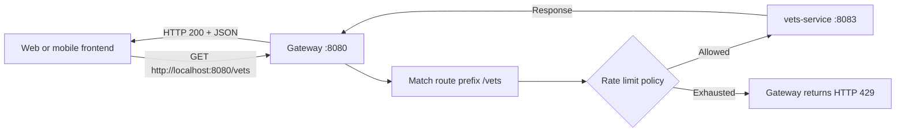
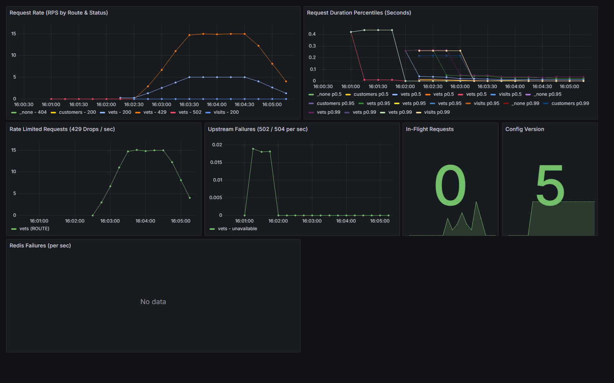

# Distributed API Gateway

Experimental HTTP/1.1 API gateway built with **Java 21** and **Reactor Netty**. It provides routing, local or Redis-backed token bucket rate limiting, passive upstream recovery, versioned configuration and Prometheus/Grafana observability. It has not been hardened or benchmarked for production use.

A separate [production deployment template](deploy/production/README.md) now covers HTTPS ingress, private services, upstream allowlisting, trusted client identity, and strict Redis failure behavior. It requires environment-specific verification before use.

---

## Table of Contents

- [Overview](#overview)
- [Why an API Gateway? (Architecture Flow)](#why-an-api-gateway-architecture-flow)
  - [Without an API Gateway (Direct Client-to-Service)](#without-an-api-gateway-direct-client-to-service)
  - [With Distributed API Gateway (Centralized Entry Point)](#with-distributed-api-gateway-centralized-entry-point)
- [System Architecture: Data Plane vs. Control Plane](#system-architecture-data-plane-vs-control-plane)
- [Core Features](#core-features)
- [Project Modules](#project-modules)
- [Reference Demo Microservices](#reference-demo-microservices)
- [Quick Start](#quick-start)
- [Request flow from a frontend](#request-flow-from-a-frontend)
- [Configuration Reference](#configuration-reference)
- [Observability & Monitoring](#observability--monitoring)
- [Dynamic Reconfiguration & Rollback](#dynamic-reconfiguration--rollback)
- [Automated Verification Scripts](#automated-verification-scripts)

---

## Overview

Modern microservices often expose multiple HTTP services. This gateway provides one configurable entry point for local experiments with routing and traffic management.

**Distributed API Gateway** solves this by sitting between external clients and backend microservices:
1. **Single Public Entry Point:** Clients communicate with one domain/port; internal services remain private.
2. **Traffic Protection:** Local or Redis-backed token bucket limits requests before they reach a backend.
3. **Resilience & Fault Isolation:** Unhealthy upstream instances are automatically removed from rotation and gradually retried after a cooldown period.
4. **Runtime Updates:** Routes, rate limits, and upstreams can be modified and rolled back through the authenticated Control Plane API without restarting the gateway data plane.

---

## Why an API Gateway? (Architecture Flow)

### Without an API Gateway (Direct Client-to-Service)

When web browsers or mobile apps interact directly with backend microservices:

```text
                                Internet
                                   │
         ┌─────────────────────────┼─────────────────────────┐
         │ :8081                   │ :8082                   │ :8083
         ▼                         ▼                         ▼
┌──────────────────┐      ┌──────────────────┐      ┌──────────────────┐
│ Customer Service │      │  Visit Service   │      │   Vet Service    │
│ (Public IP/Port) │      │ (Public IP/Port) │      │ (Public IP/Port) │
└──────────────────┘      └──────────────────┘      └──────────────────┘
```

**Challenges:**
- **Exposed Attack Surface:** Every microservice must expose public ports and public IP addresses.
- **Complex Client Logic:** Clients must track multiple hostnames, ports, and API versions.
- **CORS Overhead:** Every microservice must implement and maintain cross-origin headers, causing preflight `OPTIONS` latency.
- **No Global Rate Limiting:** A burst of requests can saturate backend databases directly.
- **Client-Side Failover:** If an instance crashes, the client experiences immediate failures.

---

### With Distributed API Gateway (Centralized Entry Point)

The gateway acts as an intelligent, high-throughput reverse proxy:

```text
                         [ Web Browser / Mobile App ]
                                      │
                                      │ Single Endpoint: https://api.example.com
                                      │ (GET /owners, /pets/visits, /vets)
                                      ▼
                      ┌───────────────────────────────┐
                      │    DISTRIBUTED API GATEWAY    │
                      │  - HTTP/1.1 forwarding        │
                      │  - Path Prefix Routing        │
                      │  - Redis Token Bucket Limiter │
                      │  - Round Robin Load Balancer  │
                      │  - Hop-by-Hop Header Cleanup  │
                      └───────────────┬───────────────┘
                                      │
   ═══════════════════════════════════╪═════════════════════════════════════════════
   PRIVATE INTERNAL NETWORK (VPC / Docker Network - No Public Access)
   ═══════════════════════════════════╪═════════════════════════════════════════════
                                      │
                  ┌───────────────────┼───────────────────┐
                  ▼                   ▼                   ▼
         ┌──────────────────┐┌──────────────────┐┌──────────────────┐
         │ Customer Service ││  Visit Service   ││   Vet Service    │
         │  (10.0.1.10:8081)││  (10.0.1.11:8082)││  (10.0.1.12:8083)│
         └──────────────────┘└──────────────────┘└──────────────────┘
```

**Benefits:**
- **Deployment choice:** Backends stay on the private Compose network. The demo does not publish PetClinic or Redis ports to the host.
- **Central routing:** Clients can address one gateway endpoint. The production template terminates TLS at NGINX; API-key authentication is available per route. General identity-provider integration remains application-specific.
- **Shielded Microservices:** Requests exceeding quotas are dropped at the perimeter with `HTTP 429 Too Many Requests`.
- **Seamless Failover:** Load balancer automatically bypasses unresponsive nodes without client awareness.

---

## System Architecture: Data Plane vs. Control Plane

The project strictly decouples traffic forwarding from configuration management:

```text
                  [ External Clients ]
                           │
                           ▼
 ┌────────────────────────────────────────────────────────────┐
 │ DATA PLANE (:8080) - Java 21 & Reactor Netty               │
 │                                                            │
 │   Active Snapshot (AtomicReference<Snapshot>)              │
 │   ├── Route Matcher (Prefix resolution)                    │
 │   ├── Identity Resolver (ROUTE, API_KEY, CLIENT_IP)        │
 │   ├── Rate Limiter (Redis Lua / Local fallback)            │
 │   ├── Load Balancer (Round Robin + Passive Cooldown)       │
 │   └── Forwarder (Hop-by-hop sanitization & Streaming)      │
 └─────────────────────────▲──────────────────────────────────┘
                           │
                           │ Polls /internal/config/active (every 2s)
                           │ Replaces snapshot atomically without dropping traffic
                           │
 ┌─────────────────────────┴──────────────────────────────────┐
 │ CONTROL PLANE (:9090) - Spring Boot & PostgreSQL           │
 │                                                            │
 │   ├── Admin REST API (/admin/config/...)                   │
 │   ├── Token Authentication (Bearer token)                  │
 │   ├── Config Store (Immutable versioning & Rollback)       │
 │   └── Validation Engine (Route prefixes, URLs, policies)   │
 └────────────────────────────────────────────────────────────┘
```

- **Data Plane:** Built with Reactor Netty. Forwarding uses non-blocking I/O; throughput and latency require workload-specific measurement.
- **Control Plane:** Built with Spring Boot and PostgreSQL. It validates and versions changes, while gateways poll the active snapshot.

---

## Core Features

- **High-Throughput Reactive Proxy:** Pure Netty HTTP client/server pipeline handling streaming payloads and preserving non-hop-by-hop headers.
- **Distributed Token Bucket Rate Limiting:** Evaluates token consumption and refills atomically in Redis using Lua scripts. Supports dynamic Redis key expiration (TTL) to avoid memory leaks.
- **Resilient Fallback Modes:** If Redis experiences downtime, routes automatically degrade to in-memory local token buckets (`LOCAL_FALLBACK`) or allow traffic through (`FAIL_OPEN`).
- **Flexible Identity Resolution:**
  - `ROUTE`: Shared rate limit quota across all callers of a route.
  - `API_KEY`: Per-consumer quota identified by header `X-API-Key`, verified using constant-time SHA-256 digest matching (`ApiKeyVerifier`).
  - `CLIENT_IP`: Per-origin quota using peer network address.
- **Round-Robin Load Balancing:** Distributes requests evenly across upstream pools.
- **Passive Failure Detection:** Unresponsive or timed-out upstreams are isolated into a 10-second cooldown period, then gradually re-introduced upon recovery.
- **Standard HTTP Rate Limit Headers:** Emits `X-RateLimit-Limit`, `X-RateLimit-Remaining`, and `Retry-After` (on 429).
- **Request Draining:** On `SIGTERM`/`SIGINT`, the gateway rejects new requests with 503, waits up to 10 seconds for in-flight requests, then closes the server and Redis client.
- **Comprehensive Observability:** Prometheus metrics (`/_gateway/metrics`), health status probe (`/_gateway/health`), and structured JSON access logs.

---

## Project Modules

```text
distributed-api-gateway/
├── gateway/
│   ├── gateway-core/           # Routing, proxy pipeline, load balancing, metrics, and local limiter
│   ├── gateway-ratelimit/      # Redis distributed Token Bucket (Lettuce driver & atomic Lua script)
│   └── gateway-runtime/        # Executable binary, configuration loader, and background subscriber
├── control-plane/              # Spring Boot management API with PostgreSQL persistence
├── deploy/
│   ├── prometheus/             # Prometheus scraping configuration
│   └── grafana/                # Pre-provisioned dashboards and datasources
├── scripts/                    # Automated end-to-end and chaos test scripts
├── config/                     # Default static gateway configuration
└── compose.yaml                # Full microservices, control plane, redis, and monitoring stack
```

---

## Reference Demo Microservices

This repository uses a reference set of backend microservices based on the [Spring PetClinic Microservices](https://github.com/spring-petclinic/spring-petclinic-microservices) architecture:
- `customers-service` (`:8081`): Manages pet owners and pet records.
- `visits-service` (`:8082`): Manages clinic visit histories.
- `vets-service` (`:8083`): Manages veterinarian registries and specialties.

*Note: These backend services serve solely as a test fixture to demonstrate real routing, failover, and rate limiting behavior. The gateway is completely backend-agnostic and works with any HTTP service (Java, Node.js, Go, Python, etc.).*

---

## Quick Start

### Prerequisites
- **Windows PowerShell 5.1 or newer**, **Git**, and **Docker Desktop** with Linux containers and Docker Compose v2
- **JDK 21** for Gradle tests or running outside Docker
- **Python 3** only for the optional dashboard traffic demo

### 1. Clone and launch the demo stack

Start the gateway, reference microservices, Redis, PostgreSQL, Control Plane, Prometheus, and Grafana:

```powershell
git clone https://github.com/Hidayattt24/distributed-api-gateway.git
cd distributed-api-gateway
.\scripts\init-local-secrets.ps1
docker compose up --build -d
docker compose ps
```

Run commands from the repository root. Skip cloning if you already have the repository. If GitHub asks for access, clone with an account that can read the repository. The public root [`.env.example`](.env.example) lists all required variable names; the setup script generates their real values in the ignored **root `.env`**, used only by this local demo. Production has its own `.env.example` and ignored `deploy/production/.env`. See the [production environment guide](deploy/production/README.md#environment-files). Redis and PetClinic stay inside the Compose network. Gateway management, Prometheus and Grafana host ports bind only to `127.0.0.1`. After startup, check `curl.exe -i http://localhost:8080/vets` and `curl.exe -i http://localhost:9092/_gateway/health`.

*(Note: The first launch pulls container images and initializes the demo services; this may take 1-3 minutes).*

### 2. Send Requests Through the Gateway

All client traffic enters through the Gateway at `http://localhost:8080`:

```powershell
# Proxied to customers-service (:8081)
curl.exe -i http://localhost:8080/owners/1

# Proxied to vets-service (:8083)
curl.exe -i http://localhost:8080/vets

# Proxied to visits-service (:8082)
curl.exe -i 'http://localhost:8080/pets/visits?petId=1'

# Non-existent route returns 404 from the Gateway
curl.exe -i http://localhost:8080/unknown-path
```

### 3. Observe Rate Limiting

By default, routes are configured with a burst capacity of 10 tokens and a refill rate of 5 tokens/second. Sending a rapid burst will result in HTTP `429 Too Many Requests`:

```powershell
# Send 60 concurrent requests to observe rate limiting in action
$client = [System.Net.Http.HttpClient]::new()
$tasks = 1..60 | ForEach-Object { $client.GetAsync("http://localhost:8080/vets") }
[System.Threading.Tasks.Task]::WaitAll($tasks)
$tasks | ForEach-Object { [int]$_.Result.StatusCode } | Group-Object | Select-Object Name, Count
$client.Dispose()
```

If Windows PowerShell reports that `HttpClient` is missing, first run `Add-Type -AssemblyName System.Net.Http`. The summary should show both `200` and `429`; counts depend on request timing and the bucket's current tokens.

### 4. Open monitoring and stop the demo

Open Grafana at `http://localhost:3000` (user `admin`; password `GRAFANA_ADMIN_PASSWORD` in `.env`), then open **Distributed API Gateway Overview**. Prometheus is at `http://localhost:9091`. When finished, run `docker compose down` from the repository root. This preserves PostgreSQL data; `docker compose down -v` also deletes the local database volume.

---

## Request flow from a frontend



Set your frontend's API base URL to `http://localhost:8080` for this local demo and call `/vets` or another configured path. The frontend does not call the internal PetClinic address. The gateway matches the path prefix, checks its policy, forwards the original path, and returns the upstream response. An empty bucket produces `429` with `Retry-After`; requests are not queued automatically. A browser frontend on a different origin also needs a CORS policy in its hosting/proxy layer or upstream service. Do not embed secret API keys in browser code; keep them on a trusted server or use an appropriate user authentication design.

---

## Configuration Reference

The source file [`config/gateway.properties`](config/gateway.properties) supplies the **initial configuration**. On the first Compose startup, the control plane stores that snapshot in PostgreSQL; its container environment overrides the sample `localhost` upstreams with Compose service names. On later startups, editing the file alone does **not** change the active database snapshot. Use the control plane API to publish a new version, or reset the local database volume only when you intentionally want a fresh demo. The gateway polls the active version about every two seconds and applies it without a restart.

Example route and policy settings:

```properties
# Gateway server settings
gateway.port=8080
gateway.response-timeout-seconds=5

# Route list
routes=customers,visits,vets

# Route definitions
route.customers.prefix=/owners
route.customers.upstream=http://customers-service:8081

route.vets.prefix=/vets
route.vets.upstream=http://vets-service:8083

# Rate limit policies
rateLimit.vets.enabled=true
rateLimit.vets.capacity=10
rateLimit.vets.refillTokensPerSecond=5
rateLimit.vets.keyType=ROUTE
rateLimit.vets.failureMode=LOCAL_FALLBACK

# Distributed Redis state (optional; uses in-memory limiter when omitted)
redis.url=redis://redis:6379
```

`route.vets.prefix=/vets` selects incoming `/vets` paths; `route.vets.upstream` names the private service that receives them. `capacity=10` allows an initial burst of ten tokens; `refillTokensPerSecond=5` replenishes five tokens each second up to capacity. `keyType=ROUTE` shares one bucket among callers; `CLIENT_IP` separates buckets by resolved client IP; `API_KEY` separates buckets by validated key and requires SHA-256 hashes via `RATE_LIMIT_VETS_API_KEY_SHA256`. Redis is optional outside Compose; the demo Compose stack enables distributed quota storage through `REDIS_URL`.

The operator-owned `GATEWAY_ALLOWED_UPSTREAMS` list restricts published destinations. If you add an upstream in the control plane, add its exact scheme, host and port to that list on both the gateway and control plane first. The allowed list is a deployment setting, not a field that an admin route update can expand.

### Supported Identity Key Types
| Key Type | Description |
|---|---|
| `ROUTE` | Global route-level bucket. All callers share the token pool. |
| `API_KEY` | Per-key bucket identified by `X-API-Key` header. Keys are validated against SHA-256 digests. |
| `CLIENT_IP` | Per-IP bucket based on peer TCP address. |

### Redis Failure Modes
| Mode | Behavior when Redis is unavailable |
|---|---|
| `LOCAL_FALLBACK` *(Default)* | Automatically switches to an in-memory Token Bucket to maintain traffic protection. |
| `FAIL_OPEN` | Passes requests through without rate limit enforcement to prioritize availability. |
| `FAIL_CLOSED` | Returns HTTP 503 with `Retry-After` when Redis cannot decide; suitable for strict shared quotas. |

The gateway returns `200` when an allowed upstream responds successfully, `401` for a missing or invalid key on an `API_KEY` route, `429` when the quota is exhausted, and `503` for an unavailable strict Redis decision or an overloaded/draining gateway. Other upstream response codes pass through as appropriate.

---

## Observability & Monitoring

The stack comes out-of-the-box with full observability:

- **Grafana Dashboard:** `http://localhost:3000` (user `admin`; password in the ignored `.env` file)
  - Real-time RPS (Requests Per Second) by route and status code.
  - Request duration quantiles (p50, p95, p99).
  - Rate limiting drop rate (HTTP 429).
  - Upstream failure rate (HTTP 502/504).
  - In-flight request count and active configuration version.
- **Prometheus Targets:** `http://localhost:9091`
- **Gateway Health Probe:** `http://localhost:9092/_gateway/health`
  - Returns `200 OK` when all upstreams are healthy, or `503 Service Unavailable` if an upstream is in cooldown.
- **Gateway Prometheus Metrics:** `http://localhost:9092/_gateway/metrics`

### Local dashboard example

The screenshot below is from a local PetClinic demo using the `/vets` route, a shared `ROUTE` bucket with capacity **10** and refill **5 tokens/second**, and Redis-backed quota storage. A bounded run sent **2,400 requests** over **120 seconds** at a target of **20 requests/second**: **604 returned 200** and **1,796 returned 429**. The dashboard shows successful traffic and rejected traffic separately. This demonstrates rate-limit behavior; it is **not** a gateway throughput or production capacity benchmark.



To reproduce it on the local stack, confirm that `curl.exe -i http://localhost:8080/vets` returns 200, then run:

```powershell
python scripts/demo-traffic.py --url http://127.0.0.1:8080/vets --seconds 120 --rps 20
```

Open **Distributed API Gateway Overview** at `http://localhost:3000`, select the last **5 minutes**, and look at **Request Rate (RPS by Route & Status)** and **Rate Limited Requests**. The script accepts only a loopback HTTP `/vets` URL and caps its duration and request rate. Your counts can differ if the bucket has existing tokens or other requests arrive. Grafana plots per-second rates calculated over a one-minute window, so the line heights do not equal the total counts printed by the script.

The public gateway port (`8080`) returns 404 for `/_gateway/*`. Outside Compose, management binds to `127.0.0.1` by default. Requests larger than 1 MiB receive 413; more than 256 active requests receive 503. For routes using `API_KEY`, the gateway verifies `X-API-Key` and removes it before forwarding to the microservice.
- **Structured JSON Logging:** Every proxied request produces a clean, sanitized JSON line:
  ```json
  {"timestamp":"2026-10-22T15:30:00.123Z","method":"GET","path":"/vets","route":"vets","status":200,"durationMs":14.20,"upstream":"http://vets-service:8083","rateLimited":false,"clientIp":"172.20.0.1"}
  ```

---

## Dynamic Reconfiguration & Rollback

The Control Plane (`http://localhost:9090`) enables updating gateway routing tables and rate limit policies at runtime without restarting gateway instances:

```powershell
$secrets = Get-Content .env | ConvertFrom-StringData
$env:CONTROL_PLANE_TOKEN = $secrets.CONTROL_PLANE_TOKEN
$headers = @{ Authorization = "Bearer $env:CONTROL_PLANE_TOKEN" }

# 1. Read the complete active configuration
$active = Invoke-RestMethod http://localhost:9090/admin/config/active -Headers $headers

# 2. Change only the vets capacity and preserve all other routes/policies
$vets = $active.routes | Where-Object { $_.id -eq 'vets' }
$vets.policy.capacity = 20
$body = @{
    expectedVersion = $active.version
    responseTimeoutSeconds = $active.responseTimeoutSeconds
    routes = $active.routes
} | ConvertTo-Json -Depth 10

Invoke-RestMethod -Method Post -Uri http://localhost:9090/admin/config/versions `
    -Headers $headers -ContentType 'application/json' -Body $body

# 3. Gateway picks up the new active snapshot shortly afterward:
Invoke-WebRequest -UseBasicParsing http://localhost:9092/_gateway/version
```

The publish request replaces the **whole** active snapshot. Keep routes you are not changing in the request. Run this after the dashboard demo if you want to keep its documented ten-token capacity.

---

## Automated Verification Scripts

Only `init-local-secrets.ps1` is needed for the quick-start Docker demo. The other scripts are optional and each has a separate purpose:

| Script | When to use it |
|---|---|
| `init-local-secrets.ps1` | Create the ignored root `.env` for the local demo. |
| `demo-traffic.py` | Generate bounded localhost traffic for the Grafana screenshot. |
| `verify-petclinic.ps1` | Check routing, 404, and rate-limit responses against the demo services. |
| `verify-observability.ps1` | Check management health, metrics, and Prometheus. |
| `verify-control-plane.ps1` | Publish a temporary route change and roll it back. |
| `verify-redis-outage.ps1` | Test the selected Redis failure behavior locally. |
| `init-production-env.ps1` | Create an ignored production `.env`; not needed for the local demo. |
| `package-release.ps1` | Build release artifacts and checksums for maintainers. |

The verification scripts are useful before publishing changes; they are not services that run continuously. Run them from the repository root:

```powershell
# 1. End-to-end PetClinic routing and burst validation
.\scripts\verify-petclinic.ps1

# 2. Redis outage chaos test (validates automatic fallback during Redis failure)
.\scripts\verify-redis-outage.ps1

# 3. Dynamic route publishing, removal, and rollback validation
.\scripts\verify-control-plane.ps1

# 4. Observability and Prometheus metrics pipeline validation
.\scripts\verify-observability.ps1
```

---

## Running Automated Tests

To run the complete test suite locally (including unit, integration, and fault injection tests):

```powershell
.\gradlew.bat check
```

To run tests with task re-execution:

```powershell
.\gradlew.bat test --rerun-tasks
```

## Experiments and release preparation

- [Rate limiter comparison](experiments/README.md): deterministic token bucket versus fixed-window baseline, with [recorded results](experiments/baseline/report.md) and raw CSV. Fixed window is an experiment, not a live policy.
- [Custom backend example](examples/custom-backend/README.md): run the gateway against a Python HTTP service instead of PetClinic.
- [Release guide](RELEASING.md), [changelog](CHANGELOG.md), [contributing guide](CONTRIBUTING.md), [security policy](SECURITY.md), and [Apache-2.0 license](LICENSE).

Version `0.1.0` source is prepared locally. The gateway ZIP includes `LICENSE` and starter `config/gateway.properties`. CI builds tests, distribution archives and images; no GitHub Release or registry image has been published. Read [SECURITY.md](SECURITY.md) and verify the release checklist before considering any public deployment.
